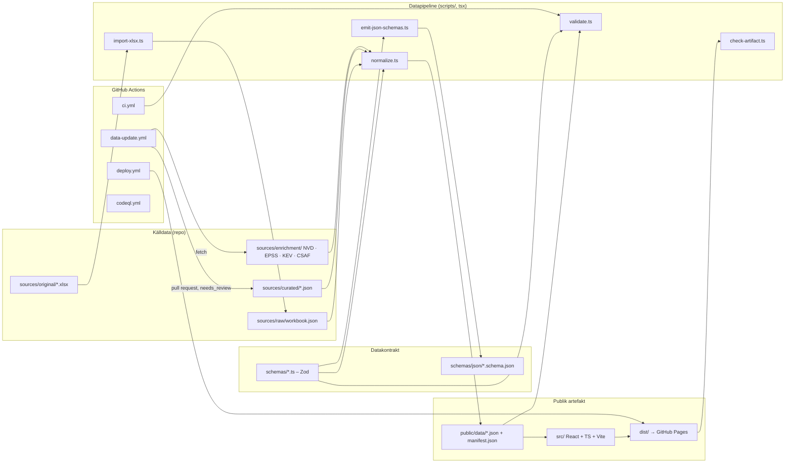

# Arkitektur

Detta dokument beskriver hur OT/IoT Security Intelligence Platform är uppbyggd, vilka tekniska
beslut som fattats och varför. Det ska räcka för att en annan utvecklare ska kunna fortsätta
arbetet utan tillgång till tidigare konversationer.

## Översikt



Kontrollera faktiska filnamn i `scripts/`, `scripts/enrich/` och `.github/workflows/`; diagrammet
visar den planerade strukturen.

## Dataflöde i detalj

1. **Import** (`scripts/import-xlsx.ts`, `scripts/lib/xlsx.ts`). Arbetsboken läses i sin helhet:
   alla blad, alla celler. Varje cell sparas verbatim med blad, rad, kolumn och rubrik i
   `sources/raw/workbook.json`. `import-report.json` räknar null-värden per kolumn, kategorier,
   dubbletter och listar antaganden. Importen fallerar om rubrikerna avviker eller om antalet
   dataposter inte är 66.
2. **Kuratering** (`sources/curated/`). Mänskligt granskad data: leverantörer, bulletiner,
   produkt–CVE–versionsmatchningar, åtgärder, källor, observationer och radvisa overrides (alias,
   livscykel, OT-roll, protokollkopplingar, parsade CVE-ID:n, oexpanderade CVE-intervall). Varje
   uppgift bär `verification_status` och `source_ids`.
3. **Enrichment-cache** (`sources/enrichment/`). Råsvar från NVD CVE API 2.0, FIRST EPSS, CISA KEV
   (filtrerad delmängd) och CSAF-dokument från Siemens ProductCERT och CISA. Cachen är
   versionshanterad så att varje bygge är reproducerbart och varje ändring syns i en diff.
4. **Normalisering** (`scripts/normalize.ts`). Slår ihop rådata, kuratering och cache till de
   publika entiteterna, härleder riskfaktorer enligt `docs/RISK_METHOD.md`, bygger sökindex och
   skriver `public/data/*.json` samt `manifest.json` (genereringstid, arbetsbokens SHA-256,
   räkningar, schema-version).
5. **Validering** (`scripts/validate.ts`). Zod-parse av varje fil, unika ID:n, referensintegritet,
   räkningar 66/55/11/18, protokoll utan CVE-matchningar, endast https-länkar och rekursiv
   kontroll mot `FORBIDDEN_PUBLIC_KEYS`. Körs som `prebuild` och i CI.
6. **Bygge och artefaktkontroll**. `tsc -b && vite build`, därefter `scripts/check-artifact.ts`
   som skannar `dist/` efter förbjudna nycklar och efter `.xlsx`-filer.
7. **Frontend** (`src/`). Läser `public/data/*.json` via `fetch`, validerar med samma Zod-scheman
   och bygger vyer. Ingen backend, inga API-nycklar.

## Tekniska beslut

| Beslut                                              | Motivering                                                                                                                                                                                                                                                                                    |
| --------------------------------------------------- | --------------------------------------------------------------------------------------------------------------------------------------------------------------------------------------------------------------------------------------------------------------------------------------------- |
| **Vite + React 19 + TypeScript**                    | Snabb utveckling, välkänt, statisk utdata som passar GitHub Pages. `base` styrs av `VITE_BASE_PATH`.                                                                                                                                                                                          |
| **Tailwind CSS 4** via `@tailwindcss/vite`          | Konsekvent design, mörkt/ljust tema med `prefers-color-scheme`, liten beroendekedja.                                                                                                                                                                                                          |
| **react-router 7 i HashRouter-läge**                | GitHub Pages saknar server-side rewrite. Hash-routing ger fungerande djuplänkar och URL-baserad filterstatus utan 404-fallback.                                                                                                                                                               |
| **Zod 4 som enda schema-sanning**                   | Samma scheman används i skript, tester och webbläsare. JSON Schema exporteras med Zods inbyggda `toJSONSchema` till `schemas/json/` för maskinläsbara kontrakt. Alla objekt är `strictObject`.                                                                                                |
| **Egen xlsx-läsare (`fflate` + `fast-xml-parser`)** | Arbetsboken använder namnrymdsprefix (`x:`) i OOXML, vilket `exceljs` inte klarar (`Cannot read properties of undefined (reading 'sheets')`). SheetJS npm-paket är inaktuellt. Den egna läsaren är ~150 rader, hanterar sharedStrings, inlineStr, str, n, b och d, och har två små beroenden. |
| **minisearch för klientsökning**                    | Litet, utan server. Index byggs i webbläsaren från `public/data`.                                                                                                                                                                                                                             |
| **Statisk JSON i repot**                            | Full spårbarhet via git, inga databaser, ingen nyckel i webbläsaren. Nya data bearbetas i GitHub Actions före bygget.                                                                                                                                                                         |
| **Versionshanterad enrichment-cache**               | Varje externt svar är granskbart i PR-diffar. Externa uppgifter kan aldrig tyst skriva över kuraterade uppgifter.                                                                                                                                                                             |
| **Separat privat schema utan data**                 | Skyddsgränsen i masterprompten. `schemas/private/` importeras aldrig av `src/`, och `FORBIDDEN_PUBLIC_KEYS` blockerar fälten i publik data.                                                                                                                                                   |
| **tsx för skript**                                  | Samma TypeScript-kod i skript och tester utan extra byggsteg.                                                                                                                                                                                                                                 |
| **Playwright med förinstallerad Chromium**          | Röktest mot `vite preview`. `PW_CHROMIUM_PATH` kan peka på en systeminstallerad binär.                                                                                                                                                                                                        |

## Frontendstruktur (planerad)

```text
src/
  app/          router (HashRouter), layout, tema, felgränser
  data/         loader som hämtar public/data/*.json och parsar med Zod; typer från schemas/
  features/     dashboard, catalog, product-detail, protocol-detail, vulnerabilities,
                advisories, data-quality, controls-guides, export, about, prioritization
  components/   tabell, filterchips, badges för verification_status, SafeLink, UnknownValue
  lib/          sök (minisearch), URL-state för filter, CSV/JSON-export med metadata
  styles/       Tailwind-ingång och tokens
```

Kontrollera faktiska katalognamn i `src/` när frontendarbetet är klart.

## Uppdaterings- och granskningspipeline

`scripts/enrich/` innehåller planerat `http.ts` (timeout, retry med backoff, rate limiting,
User-Agent, allowlist av värdar), `cve-list.ts` (vilka CVE-ID:n som ska hämtas, härledda ur
matchningar och bulletiner), `nvd.ts`, `epss.ts`, `kev.ts`, `csaf.ts`, `run.ts` (orkestrering) och
`diff.ts` (rapport över nya, ändrade, avvisade eller omklassade CVE:er, versionsändringar och
konflikter mot kuraterad data). `data-update.yml` kör pipelinen schemalagt och via
`workflow_dispatch`, skriver cachen och öppnar en pull request med etiketten `needs_review`.
Källkritiska ändringar kräver mänskligt godkännande före publicering.

## Säkerhetsgränser i arkitekturen

- Ingen kod i webbläsaren talar med externa API:er. Endast `public/data` och statiska tillgångar
  hämtas.
- Inget skript öppnar förbindelser till styrsystem eller andra interna nät; allowlisten i
  `scripts/enrich/http.ts` begränsar trafiken till dokumenterade feed-värdar.
- Se `docs/SECURITY.md` för CSP, Actions-härdning och skyddsgränstester.

## Förberedelser för fas 2

- `claims` och `history` i entiteterna ger grund för ändringsnotiser och trendsnapshots.
- `framework_refs` på kontroller förbereder IEC 62443/NIST CSF 2.0-mappning.
- `Advisory.history` och `Vulnerability.enrichment` ger underlag för tillverkarbevakning och RSS.
- Språkväxling: UI-texter samlas i komponenterna med svenska som standard; en i18n-lösning kan
  införas utan att datamodellen ändras.
- Den privata asset-modulen kräver separat autentiserad hosting och får inte aktiveras i Pages.
