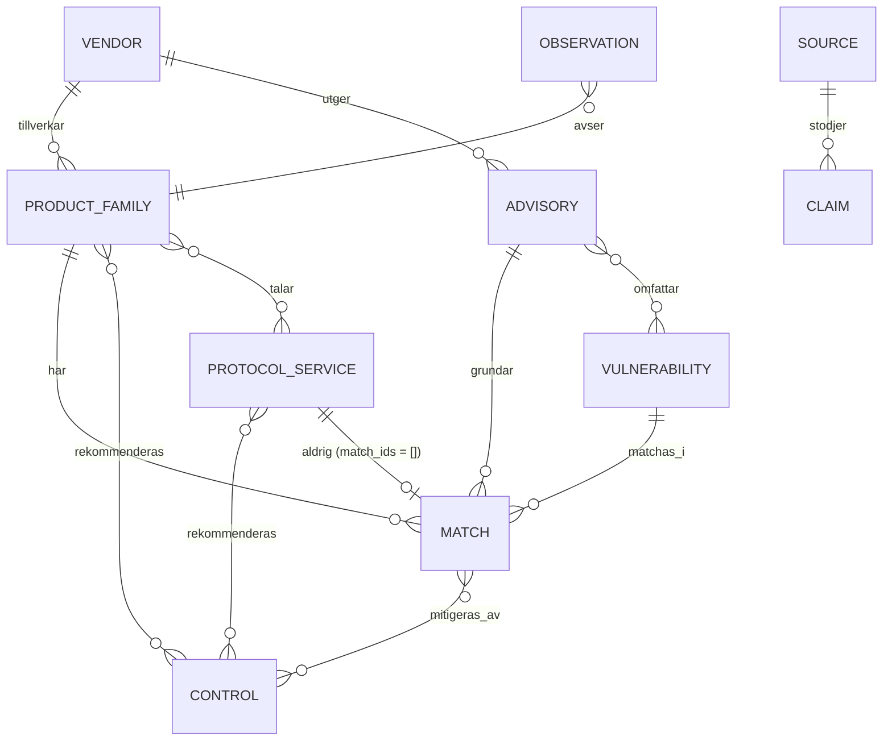

# Datamodell

Datakontraktet definieras i `schemas/` med Zod 4 och exporteras till JSON Schema i `schemas/json/`.
Alla objekt är strikta: okända nycklar ger valideringsfel. Detta dokument beskriver entiteterna,
deras fält och de regler som gäller för relationer och verifiering.

## Grundbegrepp

Plattformen skiljer konsekvent mellan sex olika saker som ofta blandas ihop:

| Begrepp                          | Vad det är                                                                     | Var det finns                                                         |
| -------------------------------- | ------------------------------------------------------------------------------ | --------------------------------------------------------------------- |
| **Produktfamilj**                | En publikt känd produktlinje (t.ex. Danfoss AK-SM 800A)                        | `product_families`                                                    |
| **Faktisk installation**         | En verklig enhet med version, nätzon och ägare                                 | **Inte i publik data.** Endast kontrakt i `schemas/private/assets.ts` |
| **Teoretisk sårbarhet**          | En publicerad CVE med sin egen status, CVSS, EPSS, KEV                         | `vulnerabilities`                                                     |
| **Fastställd versionsmatchning** | Ett explicit påstående att en viss komponent/version är berörd eller ej berörd | `product_vulnerability_matches`                                       |
| **Observerad exponering**        | Publik eller intern åtkomst till en konkret tillgång                           | **Inte i publik data.** `risk.exposure` är alltid `unknown`           |
| **Bekräftad exploatering**       | Utnyttjande i verkliga angrepp (t.ex. CISA KEV)                                | `vulnerabilities.kev`, `exploitation_evidence`                        |

## Gemensamma byggstenar (`schemas/common.ts`)

### Verifieringsstatus

| Värde                    | Betydelse                                                                                     |
| ------------------------ | --------------------------------------------------------------------------------------------- |
| `verified_primary`       | Bekräftat mot primärkälla: tillverkarens bulletin/CSAF, CERT eller NVD-post från ansvarig CNA |
| `corroborated_secondary` | Stöds av trovärdig sekundärkälla, ej bekräftat primärt                                        |
| `needs_review`           | Påståendet finns (t.ex. i arbetsboken) men kräver mänsklig granskning                         |
| `unknown`                | Uppgift saknas                                                                                |
| `disputed`               | Motstridiga uppgifter mellan källor                                                           |

### Övriga byggstenar

- `Category`: fri text (`z.string().min(1).max(60)`). 66-postsinventeringen hade 18 kategorier,
  125-postregistret 46 (t.ex. `Industriellt nät`, `EV-laddning`, `Medicinsk bild`). Kända
  kategorier får profil i `sources/curated/category_profiles.json` (grupp, `ot_impact`-default,
  motivering); okänd kategori ger `ot_impact: unknown`, aldrig en gissning. `PROTOCOL_CATEGORY =
'Tjänst'` är låst för protokoll/tjänster.
- `RegisterOrigin`: `original` (fanns i 66-postsinventeringen) eller `new` (tillkom i registret).
- `HttpsUrl`: endast `https://` tillåts.
- `Provenance`: `{ sheet, row, column, header }` – spårbarhet till Excel-cell.
- `VerifiedText`: `{ value, status, source_ids, reviewed_at, note }` för enskilda uppgifter som kan
  bli fel över tid.
- `Review`: `{ reviewed_at, reviewer (roll, aldrig person), notes[], history[] }`.
- `HistoryEntry`: `{ date, status, summary }`.
- `DataQualityFlag`: `missing_primary_source`, `missing_cve_reference`,
  `unknown_version_boundary`, `unverified_fix_version`, `possibly_outdated`,
  `needs_human_review`, `generic_control_text`, `industry_guide_only`,
  `conditional_priority_only`, `patch_level_unknown`, `unexpanded_cve_range`,
  `conflicting_sources`, `broken_link`, samt från registerimporten `setup_manual_unverified`,
  `account_name_unverified`, `initial_password_type_unknown`, `register_conflict`.

### ID-prefix

| Entitet                   | Prefix    | Exempel                                      |
| ------------------------- | --------- | -------------------------------------------- |
| Vendor                    | `vendor-` | `vendor-danfoss`                             |
| ProductFamily             | `pf-`     | `pf-danfoss-ak-sm-800a`                      |
| ProtocolService           | `svc-`    | `svc-modbus-tcp`                             |
| Vulnerability             | `cve-`    | `cve-2025-41450`                             |
| Advisory                  | `adv-`    | `adv-siemens-ssa-330084`                     |
| ProductVulnerabilityMatch | `match-`  | `match-pf-danfoss-ak-sm-800a-cve-2025-41450` |
| Control                   | `ctl-`    | `ctl-no-public-admin`                        |
| Source                    | `src-`    | `src-nvd-cve-2025-41450`                     |
| Observation               | `obs-`    | `obs-danfoss-storeview-2026`                 |
| Claim                     | `claim-`  | `claim-pf-danfoss-ak-sm-800a-fix-latest`     |
| LinkCheck                 | `lc-`     | `lc-3fa1c2d9-12`                             |
| ThreatIntel (inbäddad)    | `ti-`     | `ti-cve-2025-41450`                          |

Registrets egna ID:n (`OT-001`, `OT-N-ICSA-25-007-01`) lagras som `register.register_id` och
mappas till projekt-ID via `sources/curated/register_id_map.json`. Registerrelationer får
`match-reg-<register-id>-<cve>` (t.ex. `match-reg-ot-n-icsa-25-007-01-cve-2024-6209`).

ID:n är slugs (`^[a-z0-9]+(?:-[a-z0-9.]+)*$`), stabila över tid och får aldrig återanvändas.

### Förbjudna nycklar i publik data

`FORBIDDEN_PUBLIC_KEYS` listar nycklar som aldrig får förekomma i `public/data/` eller `dist/`:
`ip`, `ip_address`, `ipv4`, `ipv6`, `mac`, `mac_address`, `serial`, `serial_number`, `hostname`,
`site`, `site_id`, `facility`, `building`, `owner`, `asset_owner`, `contact`, `contact_email`,
`phone`, `network_zone`, `vlan`, `subnet`, `scan_result`, `shodan_result`, `exposure_confirmed`,
`ticket`, `incident_id`, `installed_version`, `actual_version`, `maintenance_window`,
`risk_acceptance`, samt autentiseringsuppgifter `password`, `password_value`, `passwd`, `secret`,
`api_key`, `credential_value`. Listan kontrolleras rekursivt av `scripts/validate.ts`, `scripts/check-artifact.ts`
och enhetstester.

## Entiteter (`schemas/entities.ts`)

### Source

| Fält                                                  | Beskrivning                                                                                                                          |
| ----------------------------------------------------- | ------------------------------------------------------------------------------------------------------------------------------------ |
| `id`, `url`, `title`, `publisher`                     | Identitet                                                                                                                            |
| `source_type`                                         | `primary_vendor`, `primary_government`, `primary_standard`, `secondary_research`, `secondary_media`, `database`, `internal_workbook` |
| `is_primary`                                          | Primär- eller sekundärkälla                                                                                                          |
| `published_at`, `last_checked_at`, `last_verified_at` | Datum                                                                                                                                |
| `availability`, `http_status`                         | `ok`, `broken`, `blocked`, `redirected`, `unchecked` från länkkontrollen                                                             |
| `supports_claims[]`                                   | `{ entity_id, field, note }` – vilka uppgifter källan stödjer                                                                        |
| `access_note`, `notes`                                | T.ex. "bot-skydd", "kräver inloggning"                                                                                               |

Registerimporten lägger till `document_sha256` (SHA-256 av hämtat dokument enligt Källmanifest
eller Hotkällor – **källmetadata, aldrig produktidentitet**), `fetched_at`, `final_url`,
`interpretation_text` (från Länkkontroll) och `register_source_key` (Käll-ID i manifestet:
`ICSA-…`, `SETUP-…`, `CVE-…`).

### LinkCheck

Länkkontroll från registret: `id`, `url` (ren sträng – kan vara `http://`, renderas aldrig som
länk om den inte är https), `http_status_text`, `final_url`, `response_sha256`,
`interpretation_text`, `checked_at`, `source_ids[]`, `entity_ids[]`. Resultatet speglas även i
`Source.availability`/`http_status`/`final_url` för källor med samma URL. Publiceras som
`link_checks.json`.

### Vendor

`id`, `name`, `aliases[]`, `security_portal_url`, `psirt_contact_url`, `support_urls[]`,
`verification_status`, `source_ids[]`, `notes`. PSIRT-länkar anges endast när de finns i
arbetsboken eller har verifierats.

### Gemensamma katalogfält (ProductFamily och ProtocolService)

`name`, `aliases[]`, `category`, `function_text` (kolumn C), `description`, `documentation[]`
(`{ url, level, level_text, product_specific, source_id }` där `level` är `product_manual`,
`hardening_guide`, `security_guidance`, `bulletin_portal`, `vendor_support`, `industry_guide`,
`standard`, `other`), `discovery_heuristic` (`{ query, caveat, purpose: 'authorized_inventory_only' }`),
`risk_summary` (originaltexterna från kolumn E–K och O), `control_ids[]`, `advisory_ids[]`,
`match_ids[]`, `observation_ids[]`, `claim_ids[]`, `risk` (se `docs/RISK_METHOD.md`),
`data_quality_flags[]`, `provenance[]`, `original` (`{ sheet, row, values }` – hela raden verbatim;
för registerposter är bladet `Register` och `values` har 36 rubriker), `verification_status`,
`source_ids[]`, `review`, samt registerblocken nedan (alla `null`/tomma för poster utan
registerkoppling).

#### RegisterInfo (`register`)

`register_id`, `origin`, `origin_reference` (”Original rad N” eller bulletin-ID),
`normalization_key`, `scope_alias_text`, `source_status_text`, `uncertainty_text`,
`exposure_risk_text`, `cve_selection_text` (registrets trunkerade urval – relationerna hämtas ur
bladet Sårbarheter), `kev_text`, `priority_text` (`P1 – verifiera omgående` / `P2 – snar
verifiering`; gäller **vid konstaterad exponering**, som aldrig är undersökt i publik data),
`control_codes[]` (K1–K7), `controls_text`, `credentials_status_text`, `change_required_text`,
`verify_login_text`, `documentation_limitation_text`, `versions_guidance_text`,
`fix_guidance_text`, `source_date_text`, `checked_at`, `observed_exposure_text` (alltid ”Ej
undersökt” i underlaget; tolkas aldrig som exponerad eller säker), `threat_selection_text`,
`threat_links_text`, `threat_tracking_text`, `limitation_text`, `threat_checked_at` och
`import` (`{ file, file_sha256, import_version, sheet, row }` – spårbarhet till importfilen).

#### Credentials (`credentials`)

`account_name` (`null` när ”Ej verifierat”, ”Ej tillämpligt” eller ”Skapas vid driftsättning”),
`account_name_text` (originaltext), `account_status_text`, `account_scope_text` (modell-/
versionsgräns för kontouppgiften), `account_source_id`, `initial_password_type` (kod),
`initial_password_type_text`, `change_requirement_text`, `commissioning_action_text`,
`password_status_source_id`, `verification_status`, `checked_at` och den låsta texten `note`:
”Underlaget innehåller inga lösenordsvärden; endast kontonamn, lösenordstyp och bytekrav.”

`InitialPasswordType` skiljer evidens som inte får blandas ihop:

| Kod                                  | Betydelse                                                          |
| ------------------------------------ | ------------------------------------------------------------------ |
| `shared_default_documented`          | Gemensamt standardlösenord dokumenterat                            |
| `default_exists_type_unknown`        | Standardlösenord förekommer, typ ej fastställd                     |
| `device_unique_documented`           | Enhetsunikt initiallösenord enligt dokumentationen                 |
| `device_unique_normal_delivery`      | Enhetsunikt initiallösenord vid normal leverans                    |
| `model_version_batch_dependent`      | Modell-/versions-/batchberoende                                    |
| `version_dependent_shared_or_unique` | Versionsberoende – gemensamt eller enhetsbundet                    |
| `set_at_commissioning`               | Lösenord väljs/skapas av installatören vid driftsättning           |
| `hardcoded_in_affected_version`      | Hårdkodade uppgifter i berörd version – kräver firmware eller byte |
| `predictable_builtin_mechanism`      | Förutsägbar inbyggd lösenordsmekanism i berörd version             |
| `not_applicable_implementation`      | Protokoll/tjänst – implementationen styr                           |
| `unknown_unverified`                 | Okänt – typen ej verifierad (**inte** ”säker” eller ”nej”)         |

#### SetupDocumentation (`setup_documentation`)

`url` (https eller `null`), `title`, `doc_type` (`direct_manual`, `doc_portal`,
`online_handbook`, `vendor_entry_unverified`, `security_guide_unverified`, `start_guide`,
`not_product`, `unverified`, `other`), `doc_type_text`, `scope_text`, `verification_text`,
`fetch_status_text`, `is_verified_setup_manual` (`false` för portaler, säkerhetsguider och
overifierade länkar – en dokumentportal är inte en verifierad installationsmanual), `source_id`,
`checked_at`.

#### ReviewFinding (`review_findings[]`)

Från bladet Radgranskning: `finding`, `uncertainty`, `status_text`, `source_ids[]`, `checked_at`.

### ProductFamily

Utöver gemensamma fält: `kind: 'product_family'`, `vendor_id`, `hardware_revisions[]`,
`lifecycle` (`{ status: active|eol_announced|eol|mixed|unknown, eol_date: VerifiedText, note }`),
`ot_role`, `ot_consequence`, `secure_configuration_notes[]`, `unexpanded_cve_ranges[]`
(`{ text, start, end, expanded, verified_ids[], note }`), `protocol_service_ids[]`.

### ProtocolService

Utöver gemensamma fält: `kind: 'protocol_service'`, `typical_use`, `default_ports[]`
(`{ port, transport, note, status, source_ids }`), `authentication`, `encryption`
(`none|optional|required|depends|unknown`), `security_notes`, `allowed_zones`.
**`match_ids` är låst till tom lista** – ett protokoll är inte en produkt och får aldrig
tilldelas produkt-CVE.

### Vulnerability

| Fält                                                                                 | Beskrivning                                                                                                             |
| ------------------------------------------------------------------------------------ | ----------------------------------------------------------------------------------------------------------------------- |
| `id`, `cve_id`                                                                       | `cve-2025-41450`, `CVE-2025-41450`                                                                                      |
| `cve_status`                                                                         | `published`, `reserved`, `rejected`, `disputed`, `unknown`                                                              |
| `nvd_status`                                                                         | NVD:s `vulnStatus` (`Analyzed`, `Deferred`, `Modified`, …)                                                              |
| `summary`, `summary_sv`                                                              | Engelsk originaltext, svensk sammanfattning                                                                             |
| `cwe_ids[]`                                                                          | `CWE-nnn`, `NVD-CWE-noinfo`, `NVD-CWE-Other`                                                                            |
| `cvss[]`                                                                             | `{ version, vector, base_score, base_severity, source, type }` – flera poster (NVD primär, CNA sekundär, v3.1 och v4.0) |
| `epss`                                                                               | `{ score, percentile, date, fetched_at }` eller `null`                                                                  |
| `kev`                                                                                | `{ listed, date_added, due_date, known_ransomware_use, vulnerability_name, catalog_version, checked_at }`               |
| `exploitation_evidence[]`                                                            | `{ type: kev                                                                                                            | vendor_statement | cert_report | public_poc | research_report | none_reported, description, date, source_ids, status }` – separata belagda signaler |
| `cna`                                                                                | CVE Numbering Authority                                                                                                 |
| `published_at`, `last_modified_at`, `references[]`, `advisory_ids[]`, `source_ids[]` |                                                                                                                         |
| `verification_status`, `enrichment`, `review`                                        | `enrichment` har `nvd_fetched_at`, `epss_fetched_at`, `kev_checked_at`                                                  |

#### ThreatIntel (`threat_intel`) och `register_cvss`

Hotunderlag per CVE från bladen Hotunderlag/Hotkällor. Fyra **separata** signaler lagras och
visas var för sig:

| Fält                                                  | Innehåll                                                                                                                         |
| ----------------------------------------------------- | -------------------------------------------------------------------------------------------------------------------------------- |
| `public_poc_status`                                   | `poc_reported`, `none_reported_at_assessment`, `unknown_missing`, `active_reported` – offentlig PoC enligt CISA SSVC vid datumet |
| `cisa_ssvc_exploitation_raw` + `cisa_assessment_date` | Råvärdet `none`/`poc`/`active`/`missing` **med datum**. `none` daterat är inte bevis för att kod eller angrepp saknas i dag      |
| `active_exploitation_status`                          | `kev_listed` eller `not_established` – aktiv exploatering är en annan uppgift än PoC                                             |
| `material_type_code` + `material_type_text`           | Vad länkat material faktiskt är: emulator/rekonstruerad PoC, detektionsverktyg, komponentexploit, officiell rapport …            |

Övrigt: `poc_url` (https), `source_critical_note` (t.ex. att en komponent-PoC inte bevisar
fjärrexploatering av en viss OT-produkt), `verification_level_text` (ingen kod har körts),
`assessment_source_id`, `record_source_id` (cveawg-post med SHA-256), `subject_product_family_id`
(registret knyter hotunderlaget till en produkt per CVE även när CVE:t berör fler),
`checked_at`.

`register_cvss` (`{ version, base_score, vector, cwe_text }`) bevarar registrets CVSS/CWE
separat från NVD:s metrics. Saknas NVD-post byggs posten från registret med
`nvd_status: 'unknown'` och `verification_status: 'needs_review'`.

### Advisory

`id`, `advisory_id` (t.ex. `SSA-330084`, `DSA-2025-03-01`, `ICSA-26-057-10`), `issuer`,
`vendor_id`, `title`, `url`, `csaf_url`, `published_at`, `updated_at`, `status`
(`interim|final|unknown`), `source_type`, `cve_ids[]`, `summary`, `history[]`, `source_ids[]`,
`verification_status`, `review`.

### ProductVulnerabilityMatch

| Fält                                                                                   | Beskrivning                                                                 |
| -------------------------------------------------------------------------------------- | --------------------------------------------------------------------------- |
| `product_family_id`                                                                    | Måste finnas; får aldrig peka på ett protokoll                              |
| `vulnerability_id`, `advisory_id`                                                      | Minst en bör anges; kan vara `null`                                         |
| `component`                                                                            | T.ex. `Desigo CC ClickOnce Client V6`                                       |
| `affected_versions_text`, `version_rule`                                               | `{ type: lt                                                                 | lte | eq      | range   | all          | unknown, version, version_end, text }`        |
| `status`                                                                               | `affected`, `not_affected`, `unknown`, `under_investigation`                |
| `attack_prerequisites`, `attack_vector`, `authentication_required`, `user_interaction` | Attackförutsättningar                                                       |
| `fix`                                                                                  | `{ available: yes                                                           | no  | partial | planned | none_planned | unknown, version, text, status, source_ids }` |
| `mitigation_control_ids[]`, `mitigation_text`                                          | Kompensatoriska skydd                                                       |
| `evidence`                                                                             | Vad matchningen bygger på                                                   |
| `source_ids[]` (minst 1), `verification_status`, `review`                              |                                                                             |
| `register_relation`                                                                    | `true` om relationen finns i registrets blad Sårbarheter                    |
| `affected_source_text`, `fixed_source_text`                                            | Exakt källtext för known affected/CNA affected och fixed-matris/osäkerhet   |
| `product_link_limitation_text`, `cwe_text`, `register_verification_note`               | Produktkopplingens begränsning, CWE-text och resultat av CSAF-verifieringen |

`version_rule.type` har även värdet `source_text`: versionsgränsen återges som källans exakta
text utan att tolkas till en jämförbar regel.

### Control

`id`, `name`, `goal`, `description`, `effect`, `limitations`, `ot_suitability`
(`high|medium|low|depends`), `requires_operational_approval`, `order_hint` (rekommenderad
ordning), `depends_on_control_ids[]`, `category_scope[]`, `protocol_scope[]`, `vendor_guide_url`,
`framework_refs[]` (`{ framework: IEC 62443|NIST CSF 2.0|NIST SP 800-82r3|CISA|Cybersäkerhetslagen,
reference, note, status: mapped_reference|informational }` – aldrig "compliant"), `source_ids[]`,
`register_code` (K1–K7 ur registrets blad Riskkontroller, `null` för övriga) och
`verification_method` (hur kontrollen verifieras enligt registret). K7
(`ctl-medical-device-coordination`) gäller medicinteknik.

### Observation

Endast aggregerade, publikt redovisningsbara observationer: `title`, `subject_ids[]`,
`method` och `period` (VerifiedText), `sample_size`, `value_text`, `uncertainty`,
`representative: false` (låst), `caveat`, `source_ids[]`, `verification_status`, `observed_at`,
`notes`. Inga värdlistor eller asset-data.

### Claim

Atomära påståenden som kan spåras och granskas: `entity_id`, `field`, `text`, `status`,
`source_ids[]`, `conflict_note`, `reviewed_at`, `history[]`.

## Dataset och manifest (`schemas/dataset.ts`)

`public/data/` innehåller en fil per entitet (`DATA_FILES`) och `manifest.json` med
`dataset_tier: 'public'`, `schema_version`, `generated_at`, arbetsbokens filnamn/SHA-256/blad,
räkningar (totalt, produktfamiljer, tjänster, kategorier, leverantörer, sårbarheter, bulletiner,
matchningar, kontroller, källor, observationer, påståenden, poster med CVE-referens, poster med
säkerhetskälla, KEV-listade, samt `register_entries`, `register_original`, `register_new`,
`register_cve_unique`, `register_relations`, `link_checks`, `threat_intel`), `imports[]` (fil,
SHA-256, importtidpunkt, importversion, blad och kontrolltal per import) och `files` (inkl.
`link_checks.json`).

## Relationer



## Exempel

### Match (Danfoss AK-SM 800A, CVE-2025-41450)

```json
{
  "id": "match-pf-danfoss-ak-sm-800a-cve-2025-41450",
  "product_family_id": "pf-danfoss-ak-sm-800a",
  "vulnerability_id": "cve-2025-41450",
  "advisory_id": "adv-danfoss-dsa-2025-03-01",
  "component": "AK-SM 8xxA Series",
  "affected_versions_text": "prior to version 4.2",
  "version_rule": { "type": "lt", "version": "4.2", "version_end": null, "text": "< 4.2" },
  "status": "affected",
  "attack_prerequisites": "Nätverksåtkomst till webbgränssnittet; användarinteraktion krävs enligt CVSS-vektorn",
  "attack_vector": "network",
  "authentication_required": "none",
  "user_interaction": "required",
  "fix": {
    "available": "yes",
    "version": "4.2",
    "text": "Uppdatera till 4.2 eller senare",
    "status": "verified_primary",
    "source_ids": ["src-nvd-cve-2025-41450"]
  },
  "mitigation_control_ids": ["ctl-no-public-admin", "ctl-network-segmentation"],
  "mitigation_text": null,
  "evidence": "NVD-post publicerad av CNA Danfoss anger AK-SM 8xxA Series prior to version 4.2; referens till DSA-2025-03-01.",
  "source_ids": ["src-nvd-cve-2025-41450", "src-danfoss-dsa-2025-03-01"],
  "verification_status": "verified_primary",
  "review": { "reviewed_at": "2026-11-07", "reviewer": "maintainer", "notes": [], "history": [] }
}
```

Fältvärdena ovan är illustrativa; kontrollera `public/data/product_vulnerability_matches.json`
för den faktiska posten.

### Vulnerability (förkortad)

```json
{
  "id": "cve-2023-6448",
  "cve_id": "CVE-2023-6448",
  "cve_status": "published",
  "nvd_status": "Analyzed",
  "summary": "Unitronics VisiLogic before version 9.9.00 ... uses a default administrative password.",
  "summary_sv": "Standardlösenord för administratör i VisiLogic före 9.9.00 ...",
  "cwe_ids": ["CWE-798", "CWE-1188"],
  "cvss": [
    {
      "version": "3.1",
      "vector": "CVSS:3.1/AV:N/AC:L/PR:N/UI:N/S:U/C:H/I:H/A:H",
      "base_score": 9.8,
      "base_severity": "CRITICAL",
      "source": "nvd@nist.gov",
      "type": "Primary"
    }
  ],
  "epss": {
    "score": 0.02089,
    "percentile": 0.81714,
    "date": "2026-11-07",
    "fetched_at": "2026-11-07T20:20:00Z"
  },
  "kev": {
    "listed": true,
    "date_added": "2023-12-11",
    "due_date": "2023-12-18",
    "known_ransomware_use": "Unknown",
    "vulnerability_name": "Unitronics Vision PLC and HMI Insecure Default Password Vulnerability",
    "catalog_version": "2026.11.06",
    "checked_at": "2026-11-07T20:20:00Z"
  },
  "exploitation_evidence": [
    {
      "type": "kev",
      "description": "Listad i CISA KEV 2023-12-11",
      "date": "2023-12-11",
      "source_ids": ["src-cisa-kev"],
      "status": "verified_primary"
    }
  ],
  "cna": "Cybersecurity and Infrastructure Security Agency (CISA)",
  "verification_status": "verified_primary"
}
```

## Regler

1. **Protokoll får inga CVE-matchningar.** `ProtocolService.match_ids` är låst till tom lista och
   `validate.ts` fallerar om en match pekar på ett `svc-`-ID.
2. **CVE-intervall expanderas bara när varje ID verifierats.** Ett intervall som
   `CVE-2025-52543–52550` lagras i `unexpanded_cve_ranges` med `expanded: false` tills varje ID
   finns i `vulnerabilities` med en NVD-post; först då sätts `expanded: true` och `verified_ids`.
3. **Extern data skriver aldrig över `verified_primary`.** Enrichment-pipelinen uppdaterar cachen
   och föreslår ändringar i en pull request. Avviker en extern uppgift från en kuraterad
   `verified_primary`-uppgift markeras påståendet `disputed` med `conflict_note`.
4. **Ingen fabricering.** Saknad uppgift blir `null` + `unknown`, en obekräftad uppgift
   `needs_review`. Patchningsgrad, exponering och fixversion får inte gissas.
5. **Exponering är alltid `unknown` i publik data.** Faktisk exponering kräver auktoriserad
   inventering i en privat modul.
6. **Spårbarhet.** Varje katalogpost har `provenance` och `original`; varje betydelsefullt
   påstående har `source_ids` eller en `Claim`. Registerposter har dessutom `register.import`
   (fil, SHA-256, importversion, blad, rad).
7. **Produkt–CVE är många-till-många.** En CVE kan beröra flera produkter (fem i registret) och
   en produkt många CVE (upp till 72). Relationen lagras per par i `product_vulnerability_matches`
   och expanderas aldrig från registrets trunkerade `cve_selection_text`.
8. **Kombinationsposter delas inte.** En registerrad som ”Schneider Electric Harmony / Pro-face
   HMI” förblir en post; modell-/versionsgränsen står i `affected_source_text` och
   `account_scope_text`, inte som separata produkter.
9. **Okänt är okänt.** ”Ej verifierat”, ”Okänt”, ”Ej undersökt” blir `null`/`unknown_unverified`/
   `unknown`, aldrig ”nej” eller ”säker”. Observerad internetexponering ”Ej undersökt” påverkar
   inte `risk.exposure`, som förblir `unknown`.
10. **Dokumenthash är källmetadata.** `document_sha256`/`response_sha256` beskriver ett hämtat
    dokument vid en tidpunkt och används aldrig som produkt- eller post-identitet.
11. **Registret skriver inte över kuraterat.** Befintliga kuraterade matchningar vinner och
    annoteras (`register_relation: true`); skillnader i CVE-mängd eller namn blir `disputed`-
    claims (`claim-register-conflict-…`) och flaggan `register_conflict`.
12. **Inga lösenordsvärden.** Endast kontonamn, lösenordstyp och bytekrav importeras; nycklar för
    lösenord är förbjudna i publik data.

## Privat asset-schema (`schemas/private/assets.ts`)

Ett datakontrakt för en framtida separat modul: `PrivateAsset` med `site`, `building`, `owner`,
`contact`, `criticality`, `network_zone`, `ip_address`, `hostname`, `serial_number`,
`installed_version`, `exposure` (`internet_exposed_confirmed|internal_only_confirmed|unknown`),
`exposure_evidence`, `maintenance_window`, `backup_and_restore`, `risk_acceptance` och
`remediation[]` (koppling till `match_id`, status, `ticket`). **Detta är enbart kontrakt, ingen
data.** Katalogen ingår inte i `tsconfig.app.json`, får inte importeras av `src/`, och fälten står
i `FORBIDDEN_PUBLIC_KEYS` så att de aldrig kan hamna i publik data av misstag.
